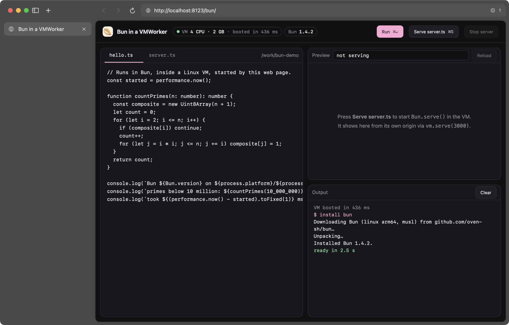

# CoolWeb

A macOS web browser with one new web API: **`VMWorker`**, a Web Worker whose script runs in its own Linux virtual machine.

```js
const vm = new VMWorker("worker.sh", { cpus: 2, memory: "512MB" });
vm.onmessage = (e) => console.log(e.data);
vm.postMessage({ hello: "vm" });
```

In every other way CoolWeb is an ordinary browser, with vertical tabs, an address bar and back and forward. Any page it loads, including a normal `https://` site, can boot Linux VMs, run real native programs in them (Node, Bun, Python, compilers, JITs), share files with them and load servers running inside them.



*The Bun demo (`examples/bun/`): an ordinary web page boots a 4-CPU Linux VM in 436 ms, installs Bun into the site's storage and runs TypeScript in it.*

## Why

[WebContainers](https://webcontainers.io) showed that people want dev environments in the browser. Browsers only offer WASM and Web Workers, so WebContainers rebuilds an operating system in JavaScript: a virtual file system, processes made from workers and a Node.js emulation layer. Native binaries such as esbuild, SWC and sharp have to be swapped for WASM builds. Language runtimes lose their JIT, because WASM code cannot generate and run new machine code.

CoolWeb takes the other route and asks what the browser could provide if it could start a real VM. A `VMWorker` is a real Linux machine with a real kernel, real processes and threads, real TCP and native binaries. JITs such as V8, JavaScriptCore, the JVM and LuaJIT run at native speed inside it. Its API is shaped like the Worker API that developers already know.

This is a proof of concept. The API is the main thing being explored, and the security model is not finished. See [Security](#security).

## Quick start

Requirements:

- A Mac with Apple Silicon
- macOS 14 or later
- Xcode 16 (Swift 6)
- `python3`
- Network access on the first build, which downloads Alpine Linux

```sh
./run.sh
```

`run.sh` does four things:

1. Builds the Linux guest (only once).
2. Builds the browser.
3. Signs the browser with the `com.apple.security.virtualization` entitlement.
4. Serves `examples/` on `http://localhost:8123` and opens the browser there.

Other pages to try:

- `http://localhost:8123/bun/` installs Bun in a VM, runs TypeScript and serves a `Bun.serve()` app in an iframe.
- `http://localhost:8123/vmworker/` has shell commands, CPU and memory settings, and a Web Worker that talks to the VM.

## The API

### `new VMWorker(scriptURL, options)`

The browser fetches the script like a Worker script, relative to the page. Then it boots a VM and runs the script inside it. The shebang line picks the interpreter.

| Option | Default | Meaning |
|---|---|---|
| `cpus` | `2` | vCPU count, enforced by the hypervisor |
| `memory` | `"512MB"` | VM memory, as a number in MB or a string like `"2GB"` |
| `network` | `true` | NAT internet access (see [Security](#security)) |
| `serialization` | `"advanced"` | `"advanced"` (structured clone over CBOR) or `"json"` (one JSON value per line, for shell scripts) |
| `mounts` | `{ "/work": <site storage root> }` | Directory handles to mount in the VM; `{}` mounts nothing |

The rest follows `Worker`:

- `postMessage(value, transfer)`
- `onmessage`, `onmessageerror` and `onerror`
- `terminate()`

There are also a few additions:

- **`exited`** is a promise, and **`onexit`** is an event. They report the script's exit code.
- **`connect()`** returns a `MessagePort` wired to the VM. You can transfer it to a Web Worker, an iframe or a Service Worker.

Messages are queued until the VM is up. VMs are tied to their document, as Workers are. Navigating away or closing the tab stops them.

### Inside the VM: stdin and stdout are the message port

A VM script reads messages on stdin and posts messages by writing to stdout. Anything written to stderr shows up in the page's devtools console. When the script exits, the VM powers off. The `$VMWORKER_SERIALIZATION` variable tells the script which wire format is in use:

- **`json`**: one JSON value per line, easy from any language including `sh`.
- **`advanced`**: each message is a `u32` big-endian length followed by one [CBOR](https://cbor.io) item. It keeps what structured clone keeps: `ArrayBuffer`, all typed arrays, `DataView`, `Map`, `Set`, `Date`, `RegExp`, `BigInt`, `Error` (including its subclass and `cause`), `undefined`, `NaN`, `-0`, cycles and shared references. It uses standard CBOR tags, so any CBOR library can read it (Python `cbor2`, Node `cbor-x`, Go, Rust).

```sh
#!/bin/sh
# A complete VMWorker script (serialization: "json"): echo every message back.
while IFS= read -r msg; do echo "{\"echo\": $msg}"; done
```

A `postMessage` with a transfer list detaches the transferred `ArrayBuffer`s. Values that can't be cloned (functions, symbols, `Blob`s and, for now, `SharedArrayBuffer`) throw a `DataCloneError` synchronously, as they would with a Worker.

### Files: `VMWorker.getDirectory()`

Each site gets persistent VM storage, much like OPFS. It is exposed through the same handle shape as the File System API:

```js
const root = await VMWorker.getDirectory();                 // like navigator.storage.getDirectory()
const file = await root.getFileHandle("app.ts", { create: true });
const w = await file.createWritable(); await w.write("console.log(1)"); await w.close();

new VMWorker("build.sh");                                    // the root is mounted at /work, the script's cwd
new VMWorker("x.sh", { mounts: { "/data": await root.getDirectoryHandle("data") } });
```

- **Supported operations:** `getFileHandle`, `getDirectoryHandle`, `removeEntry`, `resolve`, `isSameEntry`, `entries()`, `keys()` and `values()`, and async iteration.
- **Reading and writing:** `getFile()` and `createWritable()`. Writes land atomically on `close()`.
- **Persistence:** storage survives reloads and browser restarts.
- **Visibility:** changes appear in running VMs within milliseconds.
- **Web Workers:** they use the same files. Post a handle to a worker, then rebuild it there:

  ```js
  importScripts(new URL("/vmfs.js", dir.url));
  const dir = VMFileSystemHandle.from(e.data.dir);
  ```

  Each handle also has a plain `url`, so `fetch(dir.url + "notes.txt")` works from anywhere that can fetch.

### Servers: `vm.serve(port)`

```js
const url = await vm.serve(3000);   // resolves once something in the VM listens on :3000
iframe.src = url;                   // http://127.0.0.1:<port>/, a separate origin
```

The browser forwards a local port to the VM's port 3000 over vsock. The bytes pass through unchanged, so WebSockets and hot module reload work. This version is expected to change. See [Roadmap](#roadmap).

## How it works

```
 Page (WKWebView)                 CoolWeb (Swift)                         Linux VM (Virtualization.framework)
 ─────────────────                ────────────────                        ─────────────────────────────────────
 VMWorker (vmworker.js)  ──msg──► VMWorkerHost ── Box ── vsock :1024 ──►  socat ── your script's stdin/stdout
   structured clone ⇄ CBOR          (bridge)       │     hvc1 control ──►  /init: mounts, run, port forwards
                                                   │     hvc0 console ◄──  script stderr → devtools console
 Handles (vmfs.js)  ──fetch──►  per-site storage helper (kernel-sandboxed)
                                   └── ~/Library/…/VMStorage/<origin>/ ── virtiofs ──► /work
 vm.serve()          ──TCP──►  PortForwarder (127.0.0.1) ── vsock ──────►  socat ── 127.0.0.1:<port>
```

- **Hypervisor.** Apple's [Virtualization.framework](https://developer.apple.com/documentation/virtualization) runs each VM in its own sandboxed system process and uses Apple Silicon's hardware virtualization. `Box.swift` configures each machine:
  - direct kernel boot with no firmware step
  - the CPU and memory limits
  - two virtio consoles (console and control)
  - a vsock device for messages and port forwarding
  - virtiofs for the shared directories
  - NAT networking, a memory balloon and an entropy device
- **Guest.** `guest/build.sh` builds the guest from Alpine Linux 3.24 for arm64:
  - the `linux-virt` kernel, unwrapped from its EFI zboot container for `VZLinuxBootLoader`
  - an initramfs of about 5.7 MB: the Alpine minirootfs (busybox), about a dozen kernel modules decompressed ahead of time, socat, busybox-extras and the C++ runtime
  - `guest/overlay/init`, which is PID 1

  No disk image is involved.
- **Storage.** Each site's files are served by a separate helper process (`CoolWeb --storage-helper`). The helper locks itself with a macOS kernel sandbox profile that denies everything except that one site's folder. Following a VM-made symlink to `/`, or a `../`, fails in the kernel. The server code does no path checks at all. `files.html` proves this: it still passes when all of the server's path validation is deleted, and the same test does escape once the sandbox is turned off.

## Tests

```sh
scripts/test.sh
```

Every test page drives itself and reports `PASS` or `FAIL` through `document.title`. The browser runs headless for tests (`COOLWEB_HEADLESS=1`), with no window and no change of focus. Latest run on an M-series MacBook:

```
vmworker/selftest.html             PASS boot=462ms rtt_p50=2.0ms
vmworker/structured-clone.html     PASS 8MB_rtt=150ms small_p50=0.0ms
vmworker/files.html                PASS files 2052ms
vmworker/coherence.html            PASS replace content=3ms replace symlink=1087ms new file=2ms
vmworker/serve.html                PASS serve ready=63ms 50req=339ms
bun/?autotest                      PASS boot=686ms install=0.0s hello=169ms bun=1.4.2
native --selftest                  PASS
```

| Page | What it checks |
|---|---|
| `selftest.html` | Boot, messages sent before boot, CPU and memory limits, a Web Worker talking to a VM through `connect()`, round-trip latency |
| `structured-clone.html` | Every supported type through a real VM and back, transfer lists, `DataCloneError`, 8 MB throughput |
| `files.html` | Page ↔ VM ↔ Web Worker file access, custom mounts, forged mounts, symlink and `..` escapes (plus a check of the host's `/tmp`) |
| `coherence.html` | How quickly page-side changes appear inside a running VM |
| `serve.html` | `serve()` waiting until the server is up, a separate origin, edits visible on reload, parallel requests, cleanup after terminate |
| `bun/?autotest` | Installing Bun, running TypeScript, `Bun.serve()`, then editing and restarting it |
| `native --selftest` | The VM layer without the browser |

`CoolWeb --bench` measures raw VM message throughput without the browser. `examples/vmworker/bench.html` breaks down where time goes on the page side.

## Security

The core boundaries are solid:

- **Hardware VM isolation.** Guest code runs behind Apple Silicon's virtualization hardware, and Apple runs each VM in its own sandboxed process.
- **Kernel-enforced per-site storage.** Each site's files sit behind a sandboxed helper that can only reach that site's folder.
- **No cross-site access.** One site cannot reach another site's storage or mounts.

**CoolWeb is not safe for browsing untrusted websites yet.** Known gaps:

1. **VM networking bypasses web security.** With `network: true`, a VM makes raw connections from your IP without CORS, same-origin or private-network protections.
2. **No permission prompt or quotas.** Any page can start VMs and use memory, CPU and disk without limit.
3. **Served ports are open to everyone.** Any local process or website can connect to a `vm.serve()` port.
4. **Guest-facing code runs in the browser process.** Message framing and port forwarding run unsandboxed. A bug there, such as the memory disclosure found and fixed during development, runs as you. The plan is to move this code into per-site sandboxed helpers, like the storage server.
5. **Unverified downloads.** `guest/build.sh` downloads Alpine packages over HTTPS but does not check their signatures.

## Roadmap

- **Servers over `postMessage`.** HTTP requests to a VM would travel as messages on the VMWorker's own channel instead of through a loopback socket. The page's Service Worker would route `/app/*` to the VM on the page's own origin. That removes the port forwarder and gap 3 above.
- **Security.** Networking off by default, then a permission prompt and quotas, then sandboxed helpers for all guest-facing code.
- **`new VMWorker()` inside Web Workers and SharedWorkers.**
- **Binary data without base64.** WKWebView's message bridge can't carry binary data, so large messages are base64-encoded today. That costs about 200 ms of an 8 MB round trip.
- **`SharedArrayBuffer`.** Real shared memory between a page and a VM would need support in WebKit and in the hypervisor. For now it throws `DataCloneError`.

## Layout

```
Sources/CoolWeb/
  main.swift            app, window, menus, headless / test modes
  Browser.swift         tabs and navigation
  BrowserView.swift     the browser UI (SwiftUI)
  VMWorkerHost.swift    page ⇄ native bridge for one tab
  Box.swift             one VM: configuration, console / control / vsock channels, mounts, forwards
  PortForwarder.swift   vm.serve(): 127.0.0.1 port ⇄ vsock
  StorageServer.swift   per-site storage broker (starts helpers, resolves mounts)
  StorageHelper.swift   the kernel-sandboxed per-site file server
  SelfTest.swift        --selftest and --bench
  web/vmworker.js       the VMWorker API and CBOR structured-clone codec, injected into pages
  web/vmfs.js           directory and file handles, injected into pages and served to Web Workers
guest/
  build.sh              builds guest/out/Image and guest/out/initramfs.gz from Alpine
  overlay/init          PID 1 in every VM
examples/               demo and test pages (served by run.sh)
scripts/test.sh         headless test suite
experiments/            small one-off probes
```

## License

No license has been chosen yet.
